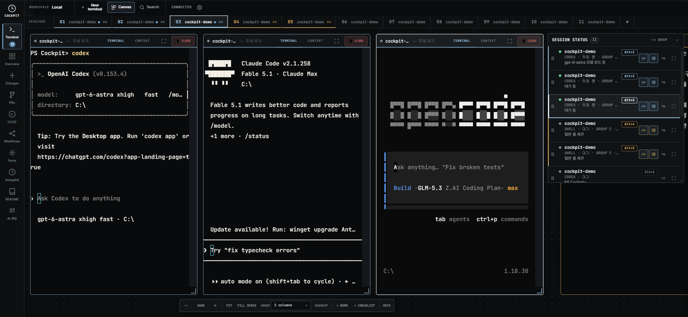
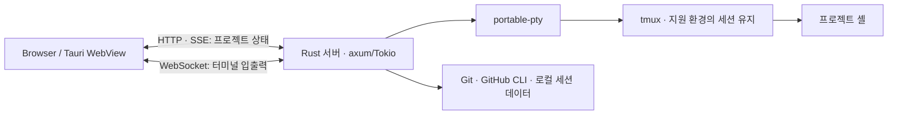

# Cockpit

**여러 프로젝트의 AI 코딩 세션과 터미널 작업을 한 화면에서 이어가는 로컬 개발 도구입니다.**

Claude Code·Codex·OpenCode로 여러 프로젝트를 작업할 때는 실행 중인 세션, 승인 대기, 수정한 파일과 CI 결과를 따로 확인해야 합니다. Cockpit은 터미널 캔버스, 에이전트 상태와 Git 작업을 연결해 **어디에 개입해야 하고 어떤 작업을 이어가야 하는지** 확인할 수 있게 합니다.

[시연 영상](docs/media/cockpit-demo.webm) · [설계 사례](#설계와-문제-해결) · [실행 방법](#실행) · [전체 기능·운영 가이드](docs/user-guide.md)

[](https://github.com/wooinwoo/agent-cockpit/actions/workflows/ci.yml)



> Codex·Claude Code·OpenCode 터미널을 나란히 배치하고, 오른쪽 Session Status에서 세션 상태를 확인하는 화면입니다.

## 해결한 문제

| 작업 중 겪는 문제 | Cockpit의 처리 | 구현 근거 |
|---|---|---|
| 여러 터미널과 프로젝트를 오가며 작업 맥락을 놓친다. | 터미널을 캔버스에 배치하고 그룹·분할·순서를 유지한다. | [터미널 UI](js/terminal-ui.js), [그룹 레이아웃](js/terminal-group-layout.js) |
| 서버를 재시작하면 셸 작업과 화면 배치가 사라진다. | 지원 환경에서 tmux 세션에 재접속하고 화면 상태를 복원한다. | [세션 복원 사례](docs/case-session-restore.md) |
| 작업 종료와 배포 가능 상태를 구분하기 어렵다. | 현재 커밋의 CI, 미커밋 변경, PR 리뷰·충돌을 조합해 Release Gate를 표시한다. 근거가 없으면 NO EVIDENCE로 남긴다. | [상태 판정](js/agent-wall-state.js) |
| 하루 종일 켜 두는 도구가 메모리를 많이 쓴다. | 서버를 Rust로 다시 작성해 대기 메모리를 72.9 MiB에서 13.2 MiB로 줄였다. 기존 데이터와 tmux 세션은 그대로 넘겼다. | [Rust 전환](#4-node-서버를-rust로-다시-쓰고-같은-데이터와-세션을-그대로-넘겼습니다), [메모리 측정](#5-대기-메모리를-729-mib에서-132-mib로-줄이고-반복-집계의-메모리-증가를-할당자에서-찾았습니다) |

Git 변경 관리, PR·CI 조회, 개발 서버 제어, 비용 조회, 승인 정책과 원격 승인도 제공합니다. 프로젝트 범위는 브라우저 UI, 로컬 서버(Rust·Node), 셸 세션 관리와 Tauri 패키징입니다. 외부 CLI와 서비스는 사용자의 설치·인증을 사용합니다.

## 설계와 문제 해결

### 1. 새 셸을 여는 것과 기존 작업을 유지하는 것을 구분했습니다

cwd와 명령만 저장하면 같은 폴더는 다시 열 수 있지만 실행 중인 셸 변수와 프로세스는 돌아오지 않습니다. Unix에서는 tmux가 셸의 수명을 담당하고, 서버는 PTY 연결을 다시 붙입니다. 별도 세션 데몬을 구현하는 대신 tmux의 기존 기능을 사용했습니다.

화면 복원은 별도 문제로 다뤘습니다. 서버가 터미널 목록을 보내기 전의 빈 상태가 기존 그룹을 덮어쓰지 않도록 하고, 서버 체크포인트와 브라우저의 ID·그룹·순서를 다시 연결합니다. 통합 검증은 재시작 후 **같은 셸 변수와 cwd, 터미널 ID·그룹·순서·분할 배치**를 확인합니다.

[복원 순서·대안·검증 범위](docs/case-session-restore.md)

### 2. 한글 입력 손실과 화면·스크롤 문제를 분리했습니다

한글 조합 확정 시점, 문자 셀 폭, 일반 셸의 스크롤백과 TUI 입력은 서로 다른 경로입니다. IME 전송 가드는 이벤트 순서와 중복 전송을 검증하고, 실제 xterm 번들에서는 한글 셀 폭과 버퍼 전환을 확인합니다. 브라우저에서는 실제 셸의 출력과 휠 이벤트로 스크롤을 검증합니다.

IME 가드가 xterm의 비공개 구조에 의존한다는 비용도 남겼습니다. 알려지지 않은 구조에는 패치를 거부하고, 업스트림 수정이 포함된 번들로 교체할 때 제거할 대상으로 관리합니다. 실제 OS 입력기를 자동 검증했다고 주장하지 않습니다.

[입력·렌더링·스크롤별 원인과 검증](docs/case-terminal-input.md)

### 3. 에이전트의 작업 종료와 검증 상태를 분리했습니다

에이전트가 멈췄거나 이전 CI가 성공했다는 이유만으로 현재 작업을 완료 처리하지 않습니다. Release Gate는 현재 브랜치·커밋에 해당하는 실행을 골라 워크플로별 최신 결과를 확인합니다. 미커밋 변경, 실행 중·실패한 CI, PR 리뷰·충돌 상태를 함께 표시하고 확인할 화면으로 연결합니다. 현재 커밋의 CI 기록이 없으면 `NO EVIDENCE`로 남깁니다.

이 표시는 조회된 근거를 요약하는 보조 판단입니다. GitHub의 필수 검사 정책 전체를 재현하거나 자동으로 병합·배포하는 기능은 아닙니다.

[상태 판정 코드](js/agent-wall-state.js) · [현재 커밋 일치·변경 파일·리뷰 대기 회귀 검증](tests/lib/agent-wall.test.js)

### 4. Node 서버를 Rust로 다시 쓰고, 같은 데이터와 세션을 그대로 넘겼습니다

하루 종일 켜 두는 도구라 서버의 대기 메모리와 프로세스 관리가 중요했습니다. Linux/WSL 서버를 Rust(axum·Tokio)로 다시 작성했습니다. 화면(HTML·CSS·JS)은 그대로 두고 API, PTY/WebSocket, 감독·작업자, 백그라운드 실행을 Rust가 처리합니다. Node 서버를 프록시하거나 내부에서 실행하지 않습니다. 기존 API 경로 178개를 옮겼고, 아직 옮기지 않은 경로는 501을 반환하도록 명시했습니다.

기준은 새 설계가 아니라 기존 동작이었습니다. 터미널 활동 판정처럼 판단이 섞인 로직은 같은 픽스처를 Node 원본과 Rust 단위 테스트가 함께 검증합니다. 비교 검증 스크립트는 Node·Rust 서버를 각각 빈 임시 저장소와 임의 포트에서 띄워 응답을 대조하며, 실제 프로젝트·계정·세션은 복사하지 않습니다.

전환에서 가장 신경 쓴 부분은 데이터 인계입니다. `--data-dir` 모드는 기존 Node 저장 경로와 tmux 세션을 그대로 이어받습니다. 2026-10-08 운영 전환에서 터미널 8개가 같은 tmux pane에 다시 연결되고, 같은 HTML과 인증 정보가 유지되고, 브라우저가 재연결되는 것을 확인했습니다. Rust 실행 파일이 없으면 조용히 Node로 돌아가지 않고 실패합니다. Node 경로는 `--node`로 명시할 때만 사용합니다.

Windows 앱은 WSL의 Rust 서비스에 연결합니다. Windows·macOS 단독 네이티브 실행은 아직 Node 서버를 사용합니다.

[전환 범위·인계 조건·검증 스크립트](rust-server/README.md) · [Node·Rust 공유 판정 픽스처](tests/fixtures/rust-activity.json)

### 5. 대기 메모리를 72.9 MiB에서 13.2 MiB로 줄이고, 반복 집계의 메모리 증가를 할당자에서 찾았습니다

같은 합성 세션 기록(8 MiB, 파일 4개)으로 비용 집계를 31초 간격으로 세 번 돌리며 서버 RSS를 쟀습니다. Rust는 release 빌드이며, 두 런타임의 집계 결과가 같은지도 함께 확인했습니다.

| 조건 | Node | Rust |
|---|---|---|
| 대기 상태 | 72.9 MiB | 13.2 MiB (관리 프로세스까지 합쳐 약 24 MiB) |
| 큰 행(1 MiB) 집계, 3회차 최고치 | 114.8 MiB | 21.0 MiB |
| 작은 행(1 KiB) 8,192개 집계, 3회차 후 | 105.3 MiB | 72.6 MiB, 수정 후 35.7 MiB |

작은 행이 많은 기록에서는 Rust도 회차마다 약 20 MiB씩 늘었습니다(32.2 → 52.3 → 72.6 MiB). 반복 폴링을 서로 다른 Tokio 작업 스레드가 처리하면서, 큰 임시 할당이 glibc의 여러 할당 영역(arena)에 남는 현상이었습니다. arena 수만 제한했을 때는 작은 기록을 추가한 뒤에도 약 20 MiB가 남았습니다. Tokio를 시작하기 전에 arena를 하나로 제한하자 32.2 → 35.6 → 35.7 MiB로 증가가 멈췄습니다(마지막 회차 증가 128 KiB). 사용자가 `MALLOC_ARENA_MAX`를 지정했다면 그 값을 따르고, 자식 AI 프로세스의 환경은 바꾸지 않습니다.

같은 조건에서 마지막 회차 증가가 8 MiB 이상이면 실패하는 회귀 검사를 측정 스크립트에 남겼습니다. Linux의 `npm start` 실행기는 `process.execve`로 Rust 관리자 프로세스로 교체돼, 실행기용 Node 프로세스가 메모리에 남지 않습니다.

이 수치는 단일 로컬 실행(2026-10-08, WSL) 결과입니다. 메모리 상한이나 장시간 누수가 없음을 보장하지 않습니다.

[측정 스크립트](scripts/measure-cost-memory.mjs) · [측정 기록과 조건](docs/benchmarks/cost-memory/)

## 구조와 기술 선택



- **Vanilla JavaScript ES Modules:** 기존 터미널 동작 모듈을 직접 서빙한다. 프레임워크 없이 DOM·상태·이벤트 수명을 관리한다.
- **Rust (axum·Tokio) HTTP + SSE + WebSocket:** Linux/WSL의 기본 서버. 상태 알림과 양방향 터미널 입출력을 분리한다. 구독자가 없으면 캐시가 있는 폴링 작업을 쉰다.
- **Node.js 서버:** Windows·macOS 단독 실행과 `--node` 선택 시 사용한다. Rust 전환의 동작 기준이기도 하다.
- **PTY(portable-pty·node-pty) + xterm.js + tmux:** 실제 셸 입출력, 브라우저 터미널, 서버와 독립적인 세션 수명을 각각 담당한다.
- **Tauri 2:** 데스크톱 앱 패키징 구성. Tailwind는 CSS 빌드에, ncc는 Node 서버 배포 번들에 사용한다.

## 실행

Node.js 22, Git이 필요하다. Linux/WSL에서는 Rust stable 툴체인과 tmux를 준비한다. `npm start`는 Linux/WSL에서 Rust release 실행 파일을 사용하고, Windows·macOS에서는 Node 서버를 사용한다.

```bash
git clone https://github.com/wooinwoo/agent-cockpit.git
cd agent-cockpit
npm ci
cargo build --release --locked --manifest-path rust-server/Cargo.toml   # Linux/WSL
npm start
```

기본 주소는 `http://localhost:3847`이다. 기본 바인딩은 모든 네트워크 인터페이스이며, localhost 외 접근에는 토큰 인증이 필요하다. 로컬에서만 사용할 경우 `COCKPIT_BIND=127.0.0.1 npm start`로 실행한다.

첫 실행 후 Overview의 설정에서 프로젝트를 등록하고 터미널을 엽니다. 일반 셸은 AI 계정 없이 사용할 수 있습니다. AI CLI·GitHub·Jira 연동은 해당 도구의 설치와 인증이 필요합니다. [OS별 설치와 설정](docs/user-guide.md#설치-가이드)을 참고하세요.

## 검증

2026-10-28, 로컬(WSL, Node.js 26)과 GitHub Actions(ubuntu-latest, Node.js 22)에서 다시 실행했습니다. 서버 재시작·스크롤 통합 검증은 CI 결과입니다. 이전 실행 기록: [portfolio-checks.json](docs/portfolio-checks.json)(2026-09-08)

| 확인 항목 | 결과와 범위 |
|---|---|
| `npm test` | 649개 중 646개 통과, 실패 0. 3개는 공개 저장소에 없는 로컬 승인 기록이 필요해 CI에서 건너뜀 |
| `cargo test --locked` | 380개 테스트 통과 |
| `npm run ui:build` | Tailwind CSS 빌드 통과 |
| Rust release 빌드 | 빈 설치에서의 시작, Node 저장 데이터 인계 검증 통과(CI) |
| 서버 재시작 | 동일 셸 변수·cwd·터미널 ID·그룹·순서·분할 배치 유지 |
| 일반 셸 스크롤 | 실제 PTY에서 300줄 출력 후 브라우저 휠로 이전 출력 탐색 |
| 브라우저 오류 | 통합 시나리오에서 미처리 실행 오류 0건 |

```bash
npm test
cargo test --locked --manifest-path rust-server/Cargo.toml
npm run ui:build
npx playwright-core install chromium
npm run test:integration
```

- **단위·회귀 검증:** Git 경계 입력, 상태 판정, 그룹 레이아웃, IME 조합 전송, 실제 xterm 번들의 문자 폭과 버퍼 전환, Node·Rust 공유 판정 픽스처.
- **실제 동작 검증:** 격리된 서버를 재시작한 후 동일한 셸 변수·cwd·터미널 ID·그룹·순서·분할 배치를 확인한다. tmux를 끈 별도의 일반 셸에서 300줄을 출력하고 브라우저 휠 동작을 확인한다.
- **CI:** push와 PR에서 두 작업을 실행한다. `verify`는 Node 테스트·CSS 빌드·Linux 통합 검증, `native`는 Rust 테스트·release 빌드·빈 설치 시작·데이터 인계 검증이다. Windows·macOS 설치 파일 빌드도 같은 Linux 검증 워크플로우를 먼저 통과해야 한다.

통합 검증은 Linux의 `/usr/bin/tmux`, `/bin/bash`, Chromium을 사용한다. 기존 Chromium을 사용할 때는 `CHROME_BIN`에 실행 파일 경로를 지정한다. 실행 중인 Cockpit 대신 임시 프로젝트·데이터·서버·tmux 소켓을 만들고 종료 시 정리한다.

[촬영 시 검증 기록](docs/media/verification.json) · [검증 스크립트](scripts/verify-portfolio.mjs) · [CI 구성](.github/workflows/ci.yml)

촬영 재현: `npm run demo:capture`. 저장 위치와 영상 범위는 [촬영 안내](docs/media/README.md)를 참고한다. 기록된 시간은 단일 로컬 실행 결과이며 성능 개선율을 의미하지 않는다.

## 현재 경계와 개선 방향

- **복원 범위:** tmux가 있는 Unix에서 서버 재시작을 견딘다. PC 재부팅이나 tmux 자체 종료를 복구하는 기능은 아니다. Windows 네이티브는 같은 프로세스 유지와 구분해야 한다.
- **네이티브 범위:** Rust 서버는 Linux/WSL의 기본 런타임이다. Windows·macOS 단독 실행의 Rust 전환은 남은 작업이며, 그동안 Node 서버를 유지한다.
- **입력 검증:** Chromium 스크롤과 IME 로직을 자동 검증한다. Windows WebView2·macOS의 실제 입력기와 TUI별 동작은 수동 검증 범위다.
- **코드 구조:** 서버 진입점과 터미널 UI에 여러 책임이 모여 있다. 현재의 큰 유지보수 경계다. 변경이 필요한 기능부터 동작 검증을 확보하고 분리할 예정이다.
- **근거의 한계:** 외부 사용자 수, 생산성 향상률, 수정 전후 FPS를 측정한 자료는 없다. 기능과 검증 결과를 중심으로 설명한다.

## 코드 탐색

```text
rust-server/    Linux/WSL 기본 서버(axum·Tokio). Node 서버와 같은 API·저장 형식
server.js       Node 서버의 HTTP·SSE·WebSocket 연결과 터미널 수명 관리
js/             터미널 캔버스·세션 상태·Git·CI 화면
lib/ · routes/  프로세스·Git·연동 서비스와 API
vendor/         브라우저에서 사용하는 로컬 라이브러리 번들
src-tauri/      데스크톱 셸과 패키징 설정
tests/          단위·회귀 테스트와 격리된 통합 검증 환경
docs/           설계 사례·운영 가이드·시연 자료
```
